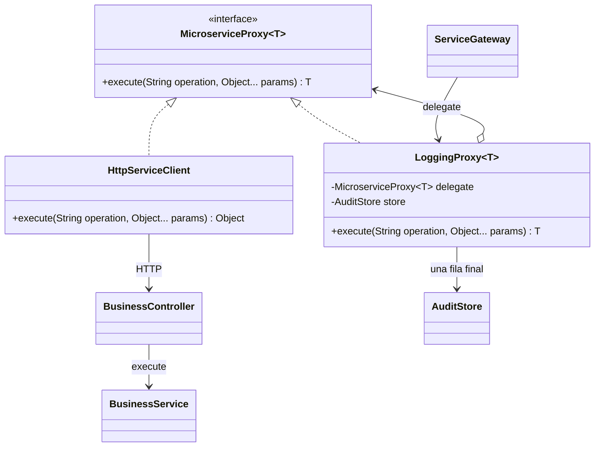
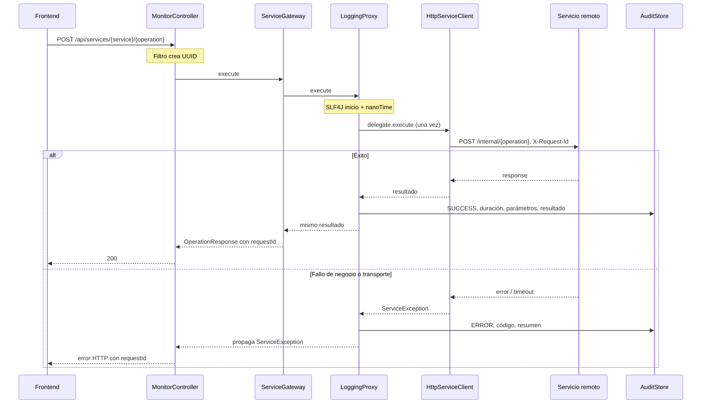

# Patrón Proxy

El contrato exacto está en `shared-contracts/src/main/java/edu/monitor/contract/MicroserviceProxy.java`:

```java
public interface MicroserviceProxy<T> {
    T execute(String operation, Object... params);
}
```

| Participante | Implementación |
| --- | --- |
| Subject | MicroserviceProxy<T> |
| Proxy | LoggingProxy<T>, recibe por composición un delegado del mismo contrato |
| Real Subject adaptado | HttpServiceClient, representa al servicio remoto y adapta el contrato común a HTTP |
| Negocio remoto real | InventoryService, OrderService, PaymentService en aplicaciones separadas |
| Client | ServiceGateway, usado por MonitorController y SimulationService |



LoggingProxy llama exactamente una vez al delegado, conserva el objeto devuelto, mide con System.nanoTime, registra SUCCESS o ERROR y propaga ServiceException. Errores inesperados se convierten en error tipado de upstream. Su catch no engloba la persistencia: una avería de auditoría nunca vuelve a ejecutar el negocio. El stack resumido conserva clase, código y hasta tres marcos, sin rutas de archivos, variables ni stack completo. No se usa AOP ni interceptor como sustituto del Proxy.



Una solicitud JSON inválida rechazada antes del Proxy no se cuenta como invocación de negocio. Una operación desconocida que llega al Proxy sí registra error. Las llamadas directas a `/internal` no se exponen al frontend ni se auditan: mantener privados los tres servicios es parte de la topología de despliegue.
