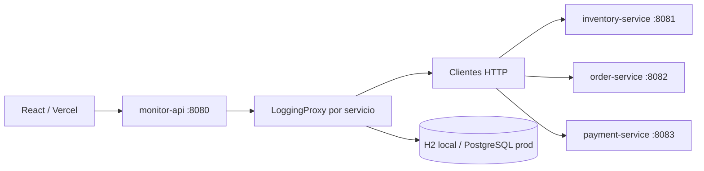

# Monitoreo de microservicios con Proxy

## Repositorios oficiales

- Backend: https://github.com/YonierProgramas/PatronProxyBackend
- Frontend: https://github.com/YonierProgramas/PatronProxyFrontend

Cada proyecto tiene su propio repositorio Git y rama `main`, con sus archivos directamente en la raíz. La carpeta superior no es un repositorio del taller. Render y Vercel permanecen sin despliegue verificado; ver DEPLOYMENT_STATUS.md para los bloqueos de conexión y plan.

Proyecto académico individual. Tres microservicios independientes de negocio, un gateway de auditoría y un frontend en un proyecto hermano. Cada aplicación se versiona desde su propia raíz; la carpeta superior no se inicializa como repositorio.

## Requisitos y decisiones

**Exigencias del profesor reportadas en el documento:** Inventario, Pedidos y Pagos; Logging Proxy para registrar uso, duración, resultados y errores; dashboard de observabilidad; fallos aleatorios con probabilidad 10% en Pagos; backend Spring Boot; repositorios independientes y despliegues públicos de frontend y API. Los detalles ampliados del documento se implementan como criterios de aceptación.

**Decisiones técnicas:** Java 21, Spring Boot 3.5.7 estable, Maven 3.9.9, React/TypeScript/Vite/Recharts, cuatro aplicaciones, contratos comunes, H2 local, PostgreSQL en producción, Flyway, operaciones específicas, métricas JSON, simulación secuencial, panel manual y puertos elegidos. Estas decisiones no se atribuyen literalmente al profesor.

## Arquitectura



| Módulo | Responsabilidad |
| --- | --- |
| shared-contracts | Contrato Proxy, DTO, errores, validación y soporte HTTP común; no tiene main |
| inventory-service | Existencias ficticias precargadas, operaciones atómicas |
| order-service | Pedidos identificados por UUID |
| payment-service | Pagos ficticios con BigDecimal y aleatoriedad inyectable |
| monitor-api | Proxy, clientes HTTP, auditoría JDBC, métricas, filtros y simulación |

El módulo común también comparte soporte HTTP pequeño para mantener respuestas uniformes; no comparte negocio ni almacenes. Los tres negocios son procesos y artefactos distintos. Los datos de negocio viven en memoria segura ante concurrencia y se pierden al reiniciar cada servicio. La auditoría local es persistente y puede sobrevivir a esos reinicios: un log histórico no implica que el pedido o pago siga en memoria.

## Despliegue preparado en Render Free

El usuario autorizó cuatro Web Services **Free**, con negocios públicos protegidos por INTERNAL_SERVICE_TOKEN, al conocer la ausencia de Private Services gratuitos. Se mantienen las cuatro JVM, LoggingProxy y endpoints. render.yaml contiene únicamente planes Free y PostgreSQL Free temporal; render.paid.example.yaml queda como referencia inactiva.

Las llamadas internas requieren el mismo secreto fuerte en los cuatro procesos; nunca se envía al frontend. Prod no arranca si falta. El gateway usa las tres URLs HTTPS reales de los negocios; la DB usa conexión privada JDBC. Vercel conserva VITE_API_BASE_URL y CORS del dominio real. No se seleccionan recursos pagos. [Pasos, límites, variables y validación](DEPLOYMENT.md). Los despliegues y URL públicas siguen pendientes de conexión y verificación.

## Requisitos locales

Java 21 en PATH y JAVA_HOME; Python 3.10+ para scripts; acceso a Maven Central la primera vez. Maven Wrapper oficial `only-script`: `mvnw`, `mvnw.cmd` y `.mvn/wrapper/maven-wrapper.properties`; esa distribución descarga Maven sin necesitar un JAR de wrapper. No se requieren Maven global, Docker, bases externas ni instalaciones globales. Frontend: Node 22.12+ y npm.

Detén los servicios antes de recompilar sus JARs (Windows puede mantenerlos bloqueados).

### Windows PowerShell

```powershell
Set-Location 'C:\Users\Jhonier\OneDrive\Documentos\Proxy\microservices-monitor-backend'
.\mvnw.cmd -B verify
.\tools\start.ps1
Get-Content .\.runtime\monitor-api.log -Tail 50 -Wait
# Ctrl+C deja de seguir el log, no detiene los servicios
.\tools\stop.ps1
```

### WSL / Bash

```bash
cd '/mnt/c/Users/Jhonier/OneDrive/Documentos/Proxy/microservices-monitor-backend'
./mvnw -B verify
bash tools/start.sh
tail -f .runtime/monitor-api.log
# Ctrl+C deja de seguir el log
bash tools/stop.sh
```

Los scripts comprueban Java, JARs y puertos antes de arrancar, esperan healthchecks y guardan PID y logs por módulo. No compilan automáticamente. Parada verifica el JAR absoluto del comando antes de enviar SIGTERM. No ejecutan kill por puerto ni detienen programas ajenos. No ejecutes dos arranques al mismo tiempo. Frontend se inicia por separado desde su README; se detiene con Ctrl+C.

Si el arranque en frío en WSL/OneDrive excede el timeout interno de 3000 ms, define `INTERNAL_TIMEOUT_MS=10000` antes de iniciar los servicios. La aceptación previa a GitHub se verificó con ese valor; un timeout sigue registrándose como ERROR y no dispara reintentos de POST.

Configuración opcional: `INVENTORY_PORT`, `ORDER_PORT`, `PAYMENT_PORT`, `MONITOR_PORT` para el script. Las aplicaciones individuales leen `PORT`. El script deriva URLs internas locales de esos puertos si no están definidas. Si cambias `MONITOR_PORT`, cambia también `VITE_API_BASE_URL`. `.env.example` es una referencia: Spring y el script no cargan `.env` automáticamente; define variables en la sesión o proveedor.

Para ejecutar un solo módulo compilado:

```bash
PORT=8081 java -Xmx192m -jar inventory-service/target/inventory-service-1.0.0.jar
```

En PowerShell: `$env:PORT='8081'` y después `java -Xmx192m -jar .\inventory-service\target\inventory-service-1.0.0.jar`.

## Auditoría y métricas

Cada invocación pública de negocio aceptada genera UUID; el filtro lo propaga por MDC y el cliente lo envía como X-Request-Id. Las solicitudes internas aceptan el UUID propagado. LoggingProxy registra el inicio por SLF4J y persiste exactamente una fila al terminar. Duración monotónica incluye la comunicación HTTP; timestamp Instant UTC al finalizar. No se cuenta polling ni healthchecks.

`successRate=successCount/totalCalls*100`, `errorRate=errorCount/totalCalls*100`, `averageDurationMs=sum(durationMs)/totalCalls` sobre éxitos y errores finalizados. Sin llamadas: tasas y promedio null. Siempre hay tres servicios. Dos consultas de conjuntos producen resumen y últimas 20 llamadas **por servicio**, orden cronológico. Logs: orden `timestamp DESC,id DESC`; page 0, size 20 por defecto, máximo 100. Fechas ISO 8601 con zona (preferentemente Z), límites inclusivos. Filtros combinables, únicamente de la tabla. La tarjeta requiere atención solo si errorRate > 15.

La simulación usa el mismo ServiceGateway y Proxy. Ejecuta 17 consultas de inventario, 17 pedidos y 16 pagos, secuencialmente (concurrencia 1). Conserva cada requestId y retorna batchId separado. Continúa ante errores, bloquea lotes simultáneos y aplica 10 segundos de separación entre inicios por instancia. Los pagos muestrean `<0.10` en cada llamada válida, también consultas de pago existente. No se exige un porcentaje exacto en 16 intentos.

Si falla persistencia, retorna `AUDIT_PERSISTENCE_FAILED`, aunque el negocio puede haber cambiado; nunca reintenta el POST. El conteo del lote considera esto un error de invocación y puede haber menos filas que completedCalls. No es posible prometer registros durables cuando la base está caída: el error se hace explícito. No se fabrican registros de reemplazo.

## Perfiles y seguridad

- `local` por defecto: H2 en `data/audit`, Flyway V1 crea esquema, consola desactivada.
- `test`: H2 efímera en memoria, reinicialización por fixture.
- `prod`: PostgreSQL, credenciales y URLs internas obligatorias, migraciones Flyway, sin ddl-auto ni consola.

Solo monitor-api usa SQL. CORS requiere orígenes explícitos; no es autenticación. Máximo 32 KiB por cuerpo POST (incluye chunked), métodos explícitos sin reflexión, timeout interno configurable (3000 ms), sin reintentos ni redirecciones HTTP, healthcheck sin detalles. Sin cuentas ni datos financieros reales. Introduce exclusivamente datos ficticios: parámetros y respuestas de negocio se auditan. No introducir nombres personales, secretos ni tarjetas en campos de ID.

Limitaciones: almacenes y auditoría sin retención automática, API académica sin autenticación, limitador de simulación por proceso (no distribuido), sin transacciones distribuidas, listas completas de negocio pueden crecer, el proyecto no pretende exposición pública irrestricta de producción empresarial. No agregues múltiples réplicas para evadir el bloqueo de lotes.

## Documentos

- [Contrato API](API_CONTRACT.md)
- [Patrón Proxy y diagramas](PATTERN_PROXY.md)
- [Despliegue y pendientes](DEPLOYMENT.md)
- [Pruebas ejecutadas](TEST_REPORT.md)
- [Matriz de cumplimiento](docs/COMPLIANCE.md)
- [Guía de sustentación](docs/DEMO.md)
- [Versiones y fuentes oficiales](docs/VERSIONS.md)

Autor, profesor, URL de API Render y URL frontend Vercel: **pendientes de completar y verificar**. Los repositorios oficiales ya fueron proporcionados; la entrega completa requiere también las URL de producción verificadas.
